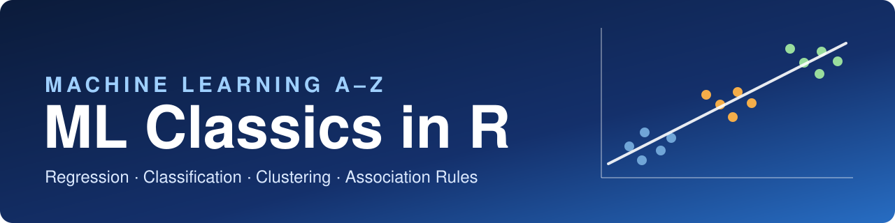
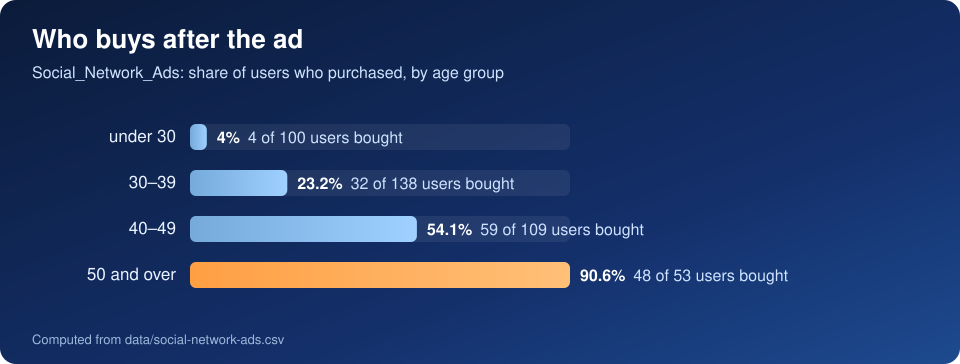

<p align="center">
  <a href="https://www.r-project.org/"></a>
  <a href="https://topepo.github.io/caret/"></a>
  <a href="https://xgboost.readthedocs.io/"></a>
  <a href="https://ggplot2.tidyverse.org/"></a>
  <a href="https://posit.co/products/open-source/rstudio/"></a>
  <a href=".github/workflows/r-check.yml"></a>
  
  
</p>

The classic machine learning algorithms implemented in **16 commented R scripts**: preprocessing, regression, classification, clustering and association rules. Each script explains the theory in the comments, fits the model on a small dataset and plots the result. This is the R mirror of [ML-Classics-in-Python](https://github.com/evgeniimatveev/ML-Classics-in-Python).

> *"One algorithm per script: 16 scripts, 2,290 lines of annotated R, ten datasets, from a straight line to XGBoost."*

---

## Course map

| # | Section | Scripts | What you work on |
|:-:|---------|:-------:|------------------|
| 00 | [Quickstart](00-quickstart/) 🎯 | 1 | Course overview |
| 01 | [Data Preprocessing](01-data-preprocessing/) 🛠️ | 1 | Missing values, encoding, split, scaling |
| 02 | [Regression](02-regression/) 📈 | 6 | Linear, polynomial, SVR, tree and forest regression |
| 03 | [Classification](03-classification/) 🎯 | 6 | Logistic, SVM, Naïve Bayes, trees, KNN, XGBoost |
| 04 | [Clustering](04-clustering/) 🧩 | 2 | K-means and hierarchical clustering of mall customers |
| 05 | [Association Rule Learning](05-association-rule-learning/) 🛒 | 1 | Apriori and FP-Growth on grocery baskets |

---

## Learning path

```
 Preprocessing ──► Regression ──────────► Classification ───────► Clustering ──► Association Rules
   missing values    linear, multiple      logistic, kernel SVM    k-means         Apriori
   encoding          polynomial, SVR       Naïve Bayes, trees      hierarchical    FP-Growth
   split + scale     tree, random forest   KNN, RF, XGBoost
```

Supervised learning comes first (predict a number, then predict a category), followed by unsupervised learning (find groups, find rules).

---

## Featured: what the data already tells you

Both charts are computed from the CSV files in [`data/`](data/).


Salaries do not grow in a straight line with the position level: the last step alone, from C-level to CEO, doubles the salary, so a straight line fits badly. That is the motivation for **polynomial regression**, **SVR** and **tree-based** models in Section 2.



In the Social Network Ads data, age is by far the strongest signal: only 4% of users under 30 purchased, against 91% of those aged 50 and over. Section 3 asks six different classifiers to learn this boundary from age and salary.

<details>
<summary>📈 Sample from <code>04-clustering/01-k-means-clustering.R</code></summary>

```r
# Loop through 1 to 10 clusters and calculate WCSS for each
for (i in 1:10) {
  wcss[i] <- sum(kmeans(X_scaled, centers = i, nstart = 25)$withinss)
}

# 📌 Step 5: Plot the Elbow Method graph
```

</details>

---

## Datasets

| File | Rows × columns | Used in | What it is |
|---|:-:|---|---|
| [`data-preprocessing.csv`](data/data-preprocessing.csv) | 10 × 4 | Section 1 | Country, age, salary, purchased: a 10-row toy table |
| [`salary-data.csv`](data/salary-data.csv) | 30 × 2 | Section 2 | Years of experience vs salary |
| [`50-startups.csv`](data/50-startups.csv) | 50 × 5 | Section 2 | R&D, administration, marketing spend, state, profit |
| [`position-salaries.csv`](data/position-salaries.csv) | 10 × 3 | Section 2 | Position level vs salary |
| [`housing.csv`](data/housing.csv) | 20,640 × 10 | Section 2 | California housing: location, rooms, income, house value |
| [`social-network-ads.csv`](data/social-network-ads.csv) | 400 × 5 | Section 3 | Age, estimated salary, purchased (0/1) |
| [`mall.csv`](data/mall.csv) | 200 × 5 | Section 4 | Annual income and spending score of mall customers |
| [`groceries.csv`](data/groceries.csv) | 38,765 × 3 | Section 5 | Member, date, item: one row per purchased item |
| [`iris.csv`](data/iris.csv) | 150 × 6 | not used by an R script | The classic Iris flowers |
| [`breast-cancer-wisconsin.csv`](data/breast-cancer-wisconsin.csv) | 569 × 33 | not used by an R script | Breast-cancer diagnosis (569 samples, 30 measurements) |

Details: [`data/README.md`](data/README.md).

---

## Script tour

<details>
<summary>🛠️ <b>Section 1 — Data Preprocessing</b> (1 scripts)</summary>

| Script | Topic |
|---|---|
| [`01-data-preprocessing-template.R`](01-data-preprocessing/01-data-preprocessing-template.R) | Reusable preprocessing template: missing values, encoding, train/test split, scaling |

</details>

<details>
<summary>📈 <b>Section 2 — Regression</b> (6 scripts)</summary>

| Script | Topic |
|---|---|
| [`01-simple-linear-regression.R`](02-regression/01-simple-linear-regression.R) | Simple linear regression: salary from years of experience |
| [`02-multiple-linear-regression.R`](02-regression/02-multiple-linear-regression.R) | Multiple linear regression: profit of 50 startups, VIF check for multicollinearity |
| [`03-polynomial-regression.R`](02-regression/03-polynomial-regression.R) | Polynomial regression: salary by position level |
| [`04-svr.R`](02-regression/04-svr.R) | Support Vector Regression compared with linear regression |
| [`05-decision-tree-regression.R`](02-regression/05-decision-tree-regression.R) | Decision tree regression (and a random forest) on California housing prices |
| [`06-random-forest-regression.R`](02-regression/06-random-forest-regression.R) | Random forest regression: salary by position level |

</details>

<details>
<summary>🎯 <b>Section 3 — Classification</b> (6 scripts)</summary>

| Script | Topic |
|---|---|
| [`01-logistic-regression.R`](03-classification/01-logistic-regression.R) | Logistic regression (with SVM and random forest for comparison) |
| [`02-kernel-svm.R`](03-classification/02-kernel-svm.R) | Kernel SVM |
| [`03-naive-bayes.R`](03-classification/03-naive-bayes.R) | Naïve Bayes classifier |
| [`04-decision-tree-classification.R`](03-classification/04-decision-tree-classification.R) | Decision tree classifier |
| [`05-knn-random-forest-xgboost.R`](03-classification/05-knn-random-forest-xgboost.R) | KNN, random forest and XGBoost |
| [`06-model-comparison-knn-rf-xgboost.R`](03-classification/06-model-comparison-knn-rf-xgboost.R) | Model comparison: KNN vs random forest vs XGBoost |

</details>

<details>
<summary>🧩 <b>Section 4 — Clustering</b> (2 scripts)</summary>

| Script | Topic |
|---|---|
| [`01-k-means-clustering.R`](04-clustering/01-k-means-clustering.R) | K-means: elbow method, silhouette, segments |
| [`02-hierarchical-clustering.R`](04-clustering/02-hierarchical-clustering.R) | Hierarchical clustering: dendrograms, optimal number of clusters, validity indices |

</details>

<details>
<summary>🛒 <b>Section 5 — Association Rule Learning</b> (1 scripts)</summary>

| Script | Topic |
|---|---|
| [`01-apriori-and-fpg.R`](05-association-rule-learning/01-apriori-and-fpg.R) | Apriori and FP-Growth on the Groceries dataset |

</details>

---

## Repository layout

```
ML-Classics-in-R/
├── 00-quickstart/                   # overview script
├── 01-data-preprocessing/           # one folder per part of the course,
├── 02-regression/                   #   each with its own README
├── 03-classification/
├── 04-clustering/
├── 05-association-rule-learning/
├── data/                            # datasets used by the scripts
├── assets/                          # README banner and charts
├── .github/                         # CI
└── ML-Classics-in-R.Rproj
```

**Why a single `main`?** This repo used to keep every part on its own branch, and the datasets on yet another one. Everything now lives on `main`, and the original branch history is preserved in the commit graph.

---

## Quick start

```bash
git clone https://github.com/evgeniimatveev/ML-Classics-in-R.git
cd ML-Classics-in-R
```

1. Open **`ML-Classics-in-R.Rproj`** in RStudio. It sets the working directory to the repo root, which the scripts rely on (e.g. `data/mall.csv`).
2. Install what a script needs with `install.packages()`; the packages are listed at the top of each script (`caret`, `xgboost`, `randomForest`, `e1071`, `factoextra`, `arules`, ...).
3. Work through the sections in order, running each script top to bottom.

---

## Continuous integration

Every push and pull request runs [`r-check.yml`](.github/workflows/r-check.yml):

| Check | What it catches |
|-------|-----------------|
| **Parse every `.R` file** | Syntax errors |
| **Absolute path scan** | Hard-coded paths such as `C:/Users/...` |
| **File-name hygiene** | Spaces in file names |

Scripts are teaching material, so they are not executed on every push. A second workflow, [`r-run-scripts.yml`](.github/workflows/r-run-scripts.yml), is **manual**: Actions → *R script smoke run (manual)* → *Run workflow*. It installs the packages, runs every script in its own R process and writes a pass/fail table to the Job Summary (about 4 minutes). Last full run: **15 of 16 scripts pass, 1 skipped**.

---

## Known limitations

- `03-classification/02-kernel-svm.R` plots decision boundaries with `ElemStatLearn`, a package that was removed from CRAN; that script cannot run on a current R.
- `View()` calls open RStudio's data viewer. Outside RStudio they fail, which is why the manual smoke run replaces `View()` with a no-op.
- Packages are not bundled: install the ones loaded at the top of each script first (on a clean machine this takes a few minutes).
- `iris.csv` and `breast-cancer-wisconsin.csv` are not used by any R script in this repo (they came along on the old `data` branch).
- Results can differ slightly between runs and package versions (random splits and cross-validation use fixed seeds, but libraries evolve).

---

## Credits

Course material: *Machine Learning A–Z (R)* by Super Data Science (as noted in [`00-quickstart/ml_classics_intro.R`](00-quickstart/ml_classics_intro.R)). The scripts are my annotated, extended working copies.

---

## Tech stack

`R` · `RStudio` · `caret` · `XGBoost` · `randomForest` · `e1071` · `ggplot2` · `arules` · `GitHub Actions`

---

*Built by [Evgenii Matveev](https://github.com/evgeniimatveev) · Data Analyst / Analytics & MLOps Engineer*
